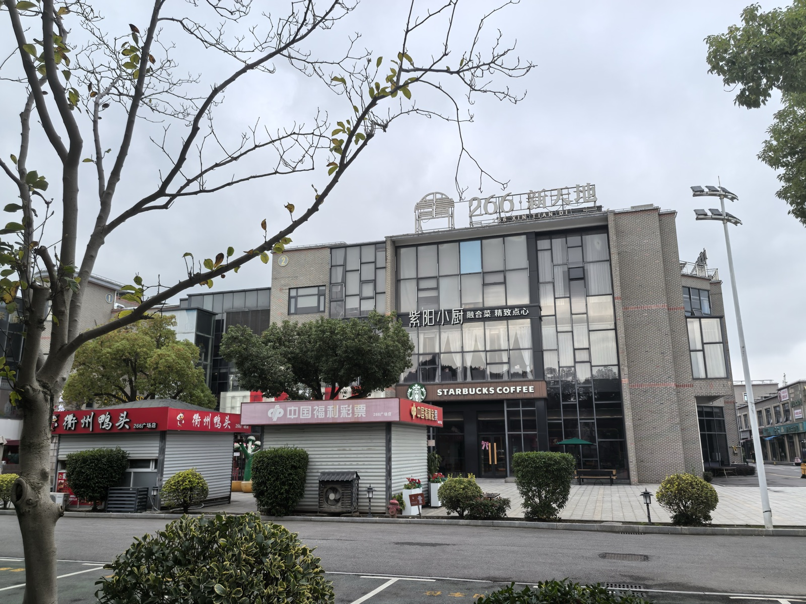
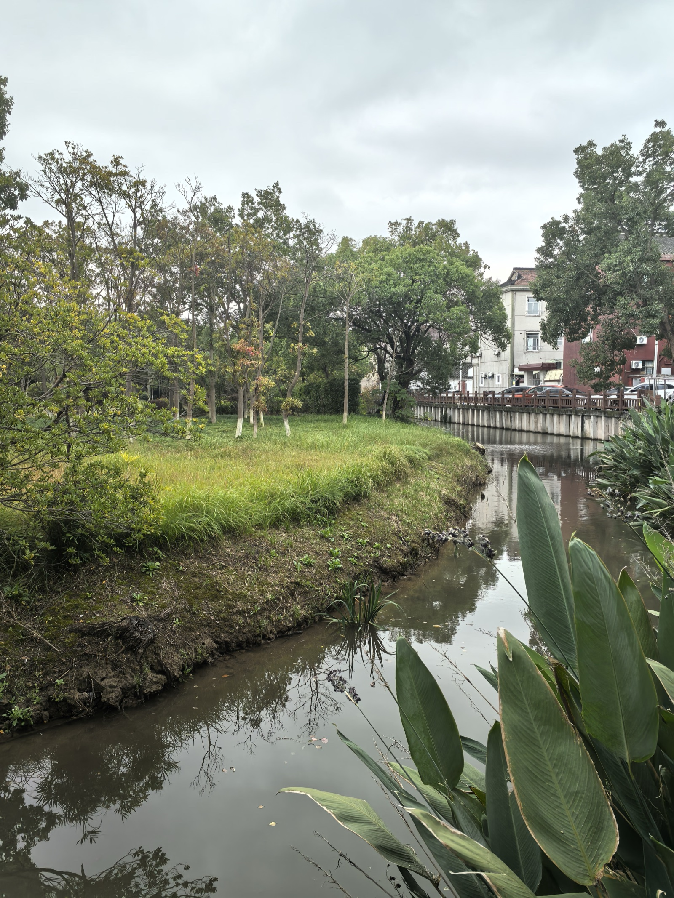
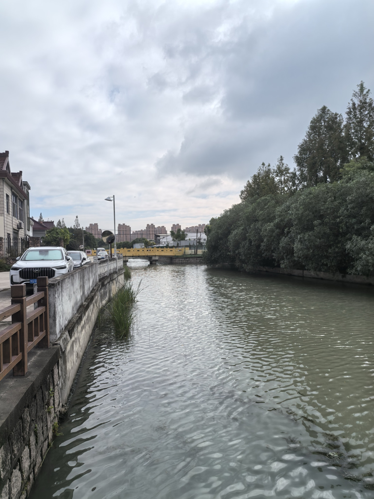
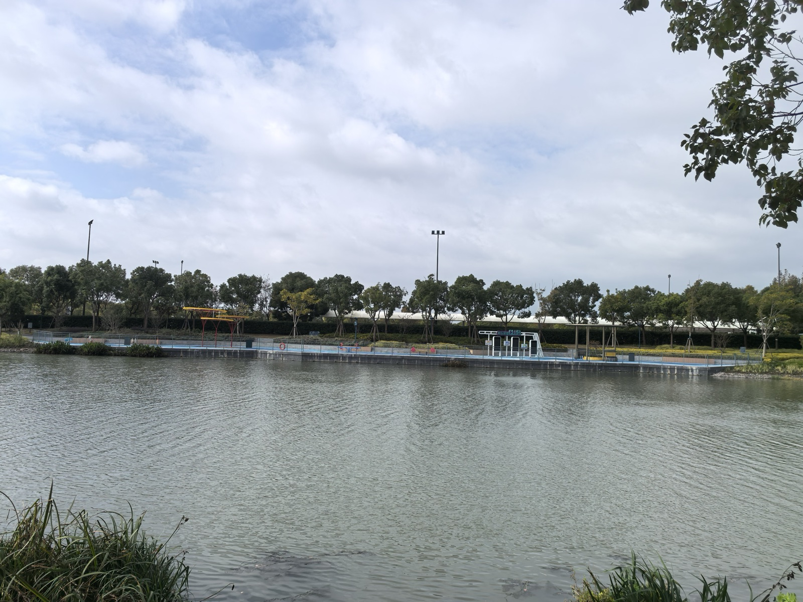

青岛学制殊异，向有中小学春秋小假之设。每值深秋十月霜降之后，黄海之滨天高云淡，恰是登高怀远之佳期。趁着孩子课业暂歇，一家三口打点行装负暄南下，暂辞浮山麦岛之海韵，客次申城浦东。

今朝天公作美，阴霾渐散，天际透出朗朗晴光。妻儿心向童话奇境，清晨便梳洗齐整，欢天喜地直奔迪士尼乐园而去，去排蜿蜒长龙，争睹飞天巡游，追寻那份绚烂无虞的童稚之乐。余年已半百，筋骨渐安于恬淡，生性向来喜静不喜闹，早过了在攒动人头中抢掠欢容的年纪。思忖片刻，倒不如将这天朗气清的秋光平分两半——由她们去重温童话梦境，余且放步于乐园周遭的村野水岸，独享半日清闲。

步出客舍，信步往乐园北界漫游，不多时便踱入了闻名遐迩的川沙“界龙村”。

昔年于海滨操持金融系统架构，亦曾久闻界龙之名，原是浦东包装印刷之翘楚、实业兴邦之典范。本以为近郊大村必尽是厂房通衢，未料信步所至，首先撞见的竟是一处颇具意味的市肆集落——“266新天地”。

宽绰的广场边缘，玻璃幕墙映着微带湿润的晨光。西风东渐的星巴克咖啡馆，与民间的衢州鸭头铺、福利彩票亭隔道相望、比肩而立。晨风之中，既有研磨咖啡之醇香，又杂着卤锅初沸之微辛。行人或西装革履手执纸杯匆匆而过，或布衣软履在彩票小窗前闲话家常。这般洋气与烟火气混融无间的景致，恰如当代浦东之缩影：既立于国际潮流之浪尖，又深扎于江南土地之肌理，读来别有一番谐趣。

穿过商肆街巷折向村落深处，喧声渐远，界龙村真正的水乡底色方才徐徐铺展。

浦东川沙古属海涂沙洲，千百年来水网纵横交错。界龙村之所以风韵卓然，正在于那未经全然人工雕凿的丰沛水系。

只见一湾碧水蜿蜒曲折，水波不兴，宛如软缎平铺于村舍田庐之间。秋水澄澈如镜，倒映着长空淡云与两岸丰茂的林木。水畔缓坡青草茸茸，虽届暮秋，却无北国衰飒枯黄之态，反而葱翠逼人。几丛宽大肥厚的美人蕉傍水玉立，叶面凝碧，疏落有致。漫步泥径之上，微风拂面，水汽清润，草木幽香沁入肺腑，令人顿觉五脏六腑皆被秋水洗涤一空。

复顺河道东行，转过一道缓弯，眼前豁然开朗，一条主干水系浩浩荡荡横陈眼前。

伫立于青石驳岸凭栏遥望，景象更为动人。左岸是修筑齐整的水泥石岸与村居小楼，白墙朱顶，绿树映门，偶有私家车马徐徐驶过；右侧则保留着原汁原味的生态岸线，整排高挺的水杉与浓绿灌木蓬勃成阵，密密层层，万千绿意直垂水面，几欲倾入碧波之中。

极目望去，一座小巧明黄的石栏拱桥横跨波心，倒影成环。而桥身尽头的高空天际线上，隐约耸立着层层叠叠的现代城市楼宇。一湾秋水，将“天然野林”、“人家炊烟”与“都市轮廓”巧妙衔接。古人所谓“人家尽枕河，水港小桥多”，在世界级超级主题乐园的咫尺之隔，竟完好安放着这方从容宁谧的水乡梦境，造化之神秀与天地之造设，实不可思议。

在水畔盘桓良久，游兴未尽。见路旁整齐码放着几排共享单车，青色车架在树荫下分外惹眼。余忽生奇想：既然身在乐园北界，何不跨上轻轮顺风南巡，沿外缘探一探迪士尼乐园东侧的景致？

扫码开锁，跨车启程。江南深秋的晨风轻掠双鬓，车轮轧过平整洁净的沥青道，沙沙作响。两旁香樟挺拔，树影如盖，一路行来脚底生风，神清气爽，颇觉重返弱冠之年的快意轻捷。

然而轻骑南下数里，正欲折入乐园东侧深处探寻开阔水泊时，忽见前方设有关防哨卡。保安师傅身着整肃制服，抬手含笑相阻：“这位师傅请留步！前方乃是乐园核心环湖景观步道与管理重地，一切共享单车及非机动车均不得入内。”

闻听此言，余勒车伫立，先是一怔，旋即忍不住抚掌失笑。

世间之事，往往巧在此等关隘之处。乐园以内，万千游人豪掷重金购得一票，甘愿忍耐数小时之漫长队列，只为换得须臾之间的光影惊艳；而乐园之外，一道森严有序的门禁规矩，便将凡俗的车马轻骑客气地挡在仙境之外。这声“单车不许入内”，既非刁难，亦无恶意，倒像是一记幽默的当头棒喝，提醒行客莫要太贪心。

既然单车难越雷池，余亦绝无强求之意。顺势将车妥帖泊入路旁白线之内，徒步轻身转至临水步道。

绕过林荫，极目远眺，一方浩浩汤汤的阔大水域（迪士尼星愿水泊外缘）赫然展露于天地之间。

好一汪澄碧无际的人工浩淼！视野顿然空阔，心胸为之一爽。

但见湖水浩瀚，在天光秋阳之下泛起粼粼碎金。近水处菖蒲水草迎风轻曳，隔水远眺，对岸的观景码头、蓝色亲水廊架如工笔细描般端整静立；后方则是层层修剪得宜的苍翠树屏与巍峨灯柱。抬头仰望，碧空如洗，素白轻云舒卷变幻，如大写意水墨般在穹苍随意泼洒。

四围阒寂无声，唯闻清风掠过林梢与浪花拍打驳岸的轻响。

此时此刻，妻儿想必正在数里外的飞天轮上尖叫欢笑，亦或在人潮如织的巡游道旁拍掌欢呼；而余则在此一湖秋水之畔，坐拥满目澄澈，独听长风浩荡。那张不可涉足的门禁，恰好成全了这一刻的物我两忘。

庄子《齐物论》有云：“天地与我并生，而万物与我为一。”天地之大，乐处原不拘一格。她们以欢腾入胜，余以沉静会心；一喧一静，一幻一真，各得其趣，各安其所。

古之达人，买山而隐；今之旅者，遇水而憩。人若心无窒碍，一弯界龙村的幽渠、一抹美人蕉的青绿、乃至被阻于门外的一汪浩渺秋湖，皆是造物者无尽之藏，皆可化作心中自在安适的“东篱草堂”。

归途乘风，日色愈朗，秋光正长。
