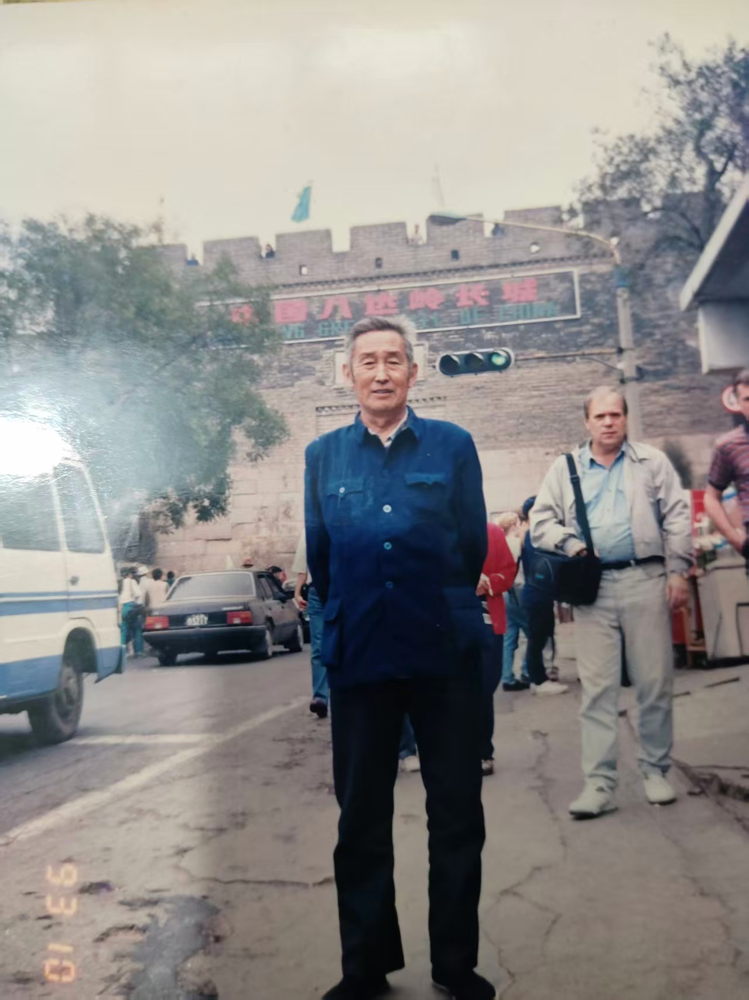

案头静卧着一帧有些年岁的旧照。

照片泛着淡淡暖黄，左下角印着一行醒目的橙红字戳：“'93 10”——那是一九九三年的金秋十月，距今已整整三十三个春秋。

背景是巍峨耸立的万里长城，城楼上“中国八达岭长城”的牌匾苍劲肃穆，关口之下游人车马如织。画面正中，祖父孙兰亭公端然独立。他身着一袭熨烫得平整利落的深蓝色中山装，四方口袋，风纪扣一丝不苟地扣至颌下；双手从容负于身后，黑色长裤与布鞋纤尘不染。虽已是霜染华发、两鬓飞雪的晚年，身形却依旧修长挺拔，宛如一株历经塞北关山风雨仍兀自端严的苍松白杨。清癯的面容上，含着一抹极平静温和的笑意，眸光清澈明亮，望向镜头处，不见一丝暮年之颓唐，尽是洗尽铅华后的斯文与厚重。

祖父辞世已有多年，然每逢展卷细抚这张小照，老人家推车进门时的铃声、唤儿孙小名时的温言软语，便如春泉破冰般自心底汩汩翻涌。

祖父讳兰亭，早年求学于山东财政学校（该校历经全国高校院系调整，后来并入了山东科技大学）。在那个百废待兴、文教初兴的年代，国家统招中专之门槛极高，能考取山东财政学校研习财经筹算之学者，皆是百里挑一、才思敏捷的拔尖苗子。在乡邻故旧口中，那是十里八乡极少见的“大有学问之人”。按常人度之，手握财经经纬之术，或可奔走仕途，或可居于高位；然而祖父性情谦退淡泊，平生不喜钻营虚浮，毕生将自己的一身才学与赤诚心力，沉潜于实体工厂的车间与账台之间。

算盘声脆，账目如铁；朝乾夕惕，恪尽职守。祖父一生在厂里默默耕耘数十年，不求显达于当世，唯求问心于毫厘。

在那段物资极度匮乏、岁月风雨如晦的年头，祖父与祖母同甘共苦、相濡以沫。夫妻二人硬是凭着工厂里一份微薄的工薪，以及两副咬紧牙关绝不言弃的铁肩膀，生生哺育、拉扯大了六男二女共八位骨肉。在那个寻常人家养活两三个孩童尚觉捉襟见肘的年月，八张嗷嗷待哺的嘴、八副长身体的骨架，每日开门七件事，柴米油盐皆是千钧重负。其间祖父与祖母咽下过多少苦水、受过多少熬煎，后辈子孙即便在盛世丰年里竭力悬揣，亦难及其万一。

在所有关于童年的斑驳记忆里，有一幕情景，深深烙印于余之骨髓，哪怕历经半世沧桑、踏遍天涯海角，至今回想起来，依然教人眼角潮润、百感交集。

那时候，老家的日常餐食单调而粗粝。摆在木桌上的，常年是硬涩坚韧的玉米煎饼，与稀薄见底、难以饱腹的玉米糊糊。细粮白面，是逢年过节方能偶见微光的稀罕珍物，对小孩子而言，白面馒头更是宛如天上甘霖般的奢求。

彼时，余与叔伯家的同龄堂兄弟共计四人，正是总觉腹中饥馑、不知愁滋味的顽皮年纪。每至薄暮黄昏，日光西斜，四双小脚丫便不约而同地守候在家门前的过道巷口。四双乌溜溜的眼睛，齐刷刷盯着巷子尽头，屏息凝神，等待着那一辆熟悉的旧自行车破开暮色而来。

远远地，一阵清脆悦耳的“叮铃铃”车铃声划破黄昏。

“爷爷回来了！”

我们四个小脑袋像雏鸟般雀跃着迎上去。祖父骑着那辆有些斑驳的二八大杠自行车，缓缓停在大门前。他先稳稳支好车撑，摘下有些发旧的布手套，看着围在车旁欢蹦乱跳的孙儿们，眼角漾开无尽的宠溺。

随即，祖父像变戏法似的，神神秘秘地将手伸进车把前挂着的布兜，小心翼翼地捧出一个雪白宣软的白面大馒头。

那不是家里蒸的，那是祖父中午在工厂食堂吃伙食时，自己宁肯饿着肠胃、咽着粗粮菜水，强忍着劳碌之饥，专门一口没舍得碰、悄悄省下来带回家的！

祖父在门前台阶上缓缓蹲下身子。那双常年握笔拨算盘、略带粗糙与老茧却沉稳异常的手，将那枚还带着他胸口体温的白馒头，仔细地、极均匀地掰成了四瓣。

“来，一人一瓣，拿好了。”

祖父的声音温润如水。四个小脑袋如捧圣物般接过那瓣热气早已散去、却散发着纯净麦香的白面馍。放进嘴里狠狠咬上一口，那股细腻绵软的甘甜瞬间在舌尖化开，直抵心脾。那是童年岁月里无法企及的琼浆玉液，那是天地间最醇厚、最难忘的人间至味。

一丸白馍，分作四瓣。祖父省下的是自己饥肠辘辘的苦楚，分给儿孙的，却是倾尽所有、毫无保留的温存。那一刻，门前黄昏的夕阳将祖父慈祥的面庞镀上一层暖金，也把这一瓣白馍的甘甜，刻进了一个孩子一生的精神命脉里。

昔贤有言：“父之笃，祖之慈，如山如海。”

后来，岁月如梭。祖父看着儿孙们一个个长大成人、开枝散叶。余亦走出鲁中故土，从青岛大学之计算工学起步，穿行于齐鲁软件与国际商机（IBM）之金融大厦之间。半生之中，走过繁华都市，尝过珍馐百味，然而每当独坐书斋、回望半生履痕，心头最滚烫、最踏实的依凭，依然是那个推着自行车、在门前将白馒头掰成四瓣的清瘦身影。

祖父一生没有留下煌煌著述，亦未挣得煊赫声名，但他留给这个家族的，是老一代齐鲁财政学人的严谨操守，是工厂老工人坚忍不拔的硬骨，更是面对贫瘠生活时那份宁苦自身、润泽后辈的浩瀚慈心。这一缕文脉与仁风，正如草堂门前的修竹野菊，虽经严霜，生生不息。

今日，东篱草堂网络初成，四海通达。孙儿谨磨浓墨，恭录往事，并将祖父当年驻足八达岭雄关之风采小照端肃嵌于卷端，勒石云山。

愿天国宁谧，长乐安康。祈祖父孙公讳兰亭于白云深处，含笑看人间桑梓葱茏，儿孙绳绳。

待来世，若有缘，儿孙仍愿守在门前，再听一回那清脆悠扬的车铃声。
