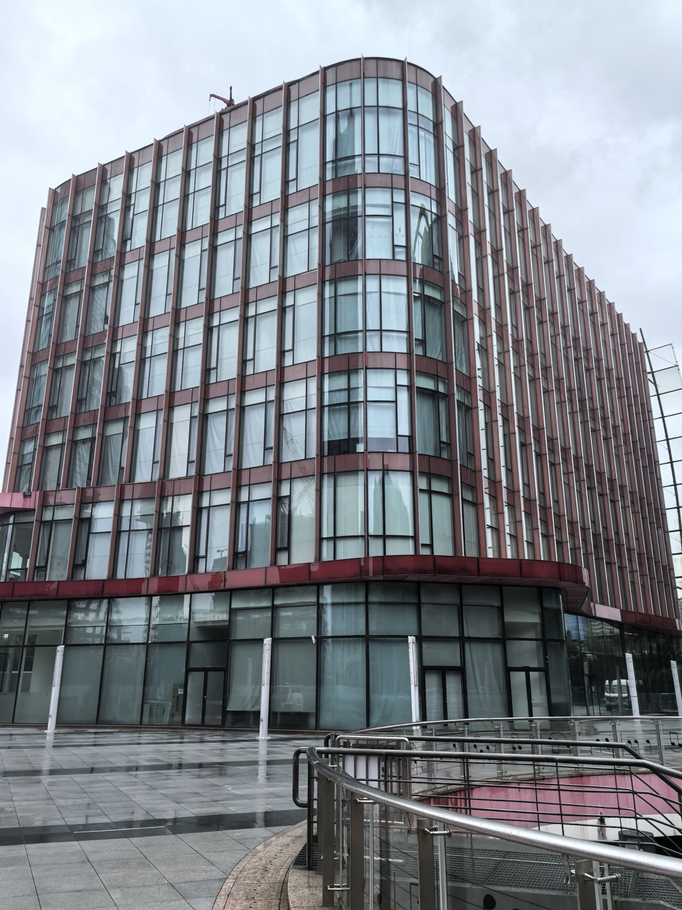
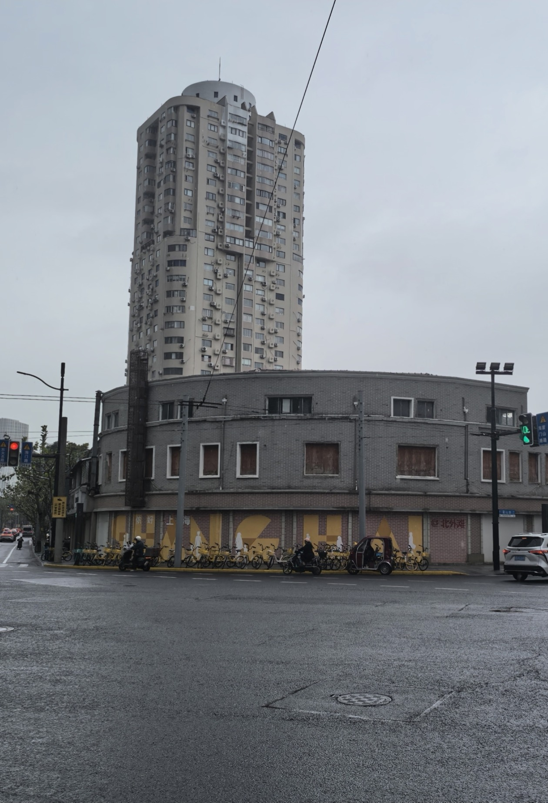

岁次丙午，适逢立冬。江南的天气收敛了秋阳的明丽，天色微溟，薄雨如织。

信步走在上海虹口北外滩的街头，湿润的沥青路面倒映着铅灰色的云影与往来车马的尾灯。冷风掠过街角，带着黄浦江特有的湿咸潮气扑面而来。不知不觉间，双脚竟又循着深埋在心底数十载的潜意识，踱到了这一方熟稔而又陌生的旧地——东大名路与提篮桥。

驻足于东大名路700号门前，极目仰望，一座巍峨气派的大厦在冬雨中昂然伫立。赭红色的金属竖向格栅如层层风帆，包裹着整肃明澈的现代玻璃幕墙，在烟雨蒙蒙的天光下泛着沉稳深邃的光泽。

凝视着这座熟悉的红色大厦，刹那间，周遭车水马龙的喧嚣仿佛骤然退去。时光的帘幕被一只无形的大手猛然拉开，整整二十四个春秋的风霜雨雪，如退潮的江水般疾速倒卷——

那是二〇〇二年的岁月，距今已整整二十四个年头。

彼时，余年方二十有八，正值筋骨强健、心气高朗的青年华茂。自齐鲁大地入职浪潮通用软件公司未久，适逢国家加入世贸组织，大型国有航运水运巨擘面临与国际接轨之全面升级。余受公司重托，作为核心系统架构与开发骨干，只身受命派驻上海，入驻东大名路700号中国海运集团（中海集团）总部，承揽其全集团内部资金管理与资金结算系统的研析与搭建。

在那个大型企业财务信息化方兴未艾的年代，跨区域资金池调度、银企直联系统集成、海量流水之勾稽与风控，皆属国内软件行业之尖端攻坚课题。

白日里，我们便是在东大名路700号这栋气派非凡的红色大厦里办公。窗外近在咫尺的黄浦江面上，万吨轮船鸣笛起航、百舸争流；室内则伴随着敲击机械键盘的清脆声响、白板上密密麻麻的系统架构与流向图，与中海集团的诸位业务行家里手反复推演架构、推敲每一笔资金结算的容灾与逻辑闭环。那是一段真正将全副心神浸润在纯粹技术、算法攻坚与业务融合中的充实时光。

而每日散工之后，容纳我们疲惫身躯与年轻梦境的，则是距离此地步行仅数分钟之遥的提篮桥。

顺着东大名路踱至提篮桥街口，眼前赫然横陈着另一处令余心头巨震的旧迹——那是一栋带着优美弧形转角、由青砖与灰砖交织砌筑的三层沿街小洋楼。

这座小楼，便是当年浪潮派驻项目团队在上海租住客次的落脚寓所。

二十四年前的提篮桥，远非今日这般肃穆齐整。那时候，就在这栋小楼的身侧，凌空架着一座极为繁华著名的“提篮桥人行过街天桥”。每日晨昏，天桥上人流如织、自行车铃声清脆交织；从小楼二三层推开临街的木窗下望，天桥上行人的伞盖、衣着几乎触手可及。

小楼的一层，当年尽数向着街市敞开，鳞次栉比地经营着极具老上海风情的市井小铺：热气腾腾的大饼油条豆浆店、底焦皮脆的生煎馒头铺、香气四溢的排骨年糕档，间杂着裁缝铺、烟杂店与修车小摊。清晨下楼，迎面是炸锅油润的香气与吴侬软语的唤客之声；暮色归来，是各家各户升起的袅袅油烟与孩童放学时的嬉闹。虽是背井离乡、客居异地，但这栋小小的转角洋楼与整条街市的融融烟火，却给了年轻游子最温存、最踏实的抚慰。

在所有关于这所小楼与中海项目的记忆中，最难以忘怀、每每思之令人唇角含笑的，莫过于与挚友宋君共度的黄昏。

宋君与余同在项目组并肩奋战，性情相投，亦师亦友。每日在东大名路700号大厦熬尽脑力、攻克完当日的代码模块后，黄昏收工回转小楼，洗尽面上尘土，二人便在楼下寻一处熟络的小店，就着两碗热气腾腾的阳春面、各添一客喷香金黄的生煎包，唏哩呼噜下肚，五脏六腑便熨帖无虞。

饭后夜幕初覆，华灯初上，正是申城一日中最惬意的时光。余与宋君绝不愿久困室内，二人总是不约而同地迈开双腿，沿着老虹口那几条铺满梧桐落叶的马路，一路向南溜达散步，信步踱至黄浦江畔的“公平路渡口”。

那时的公平路轮渡，是连接虹口与浦东陆家嘴最寻常、最质朴的过江通途。

售票窗口前，仅需掏出区区“五毛钱”，便能换得一枚小巧圆润的塑料筹码或是薄如蝉翼的轮渡客票。随着铁栅门“哗啦”一声推开，游人自行车便如潮水般涌上跳板，踏上质朴开阔的过江双层渡轮。

轮渡在略显浑浊却浩浩荡荡的江水中缓缓离岸。柴油机在脚底沉闷而有节奏地震颤着，江风带着秋夜的凉意与江水的湿润，肆无忌惮地掀动衣襟、拂过两鬓。倚立在轮渡上层的铁栏杆旁，极目西望，浦西外滩的百年花岗岩建筑在暖黄泛光灯下如同一幅缓缓展开的历史长卷；而回首东盼，江对岸则是刚刚从阡陌农田与老旧码头中拔地而起、正焕发着蓬勃生机的浦东新区。

短短十数分钟的航程，渡轮便稳稳靠泊在浦东码头。

彼时的陆家嘴，远没有今日这般被摩天大楼挤压得密不透风的压迫感。金茂大厦初展雄姿，环球金融中心与上海中心大厦尚在纸面蓝图或未见形影。在空旷深邃的夜幕之下，东方明珠广播电视塔宛如自九天垂落的璀璨神柱，那十一颗由下至上大小错落的球体，在暗夜中流光溢彩、晶莹剔透，犹如晶莹巨蚌中吐出的无价夜明珠。

余与宋君便踏着江畔习习的凉风，并肩沿着东方明珠庞大巍峨的塔座环行漫步。两个二十来岁的技术青年，昂首仰望着那座直插云霄的世纪地标，脚下步履轻快，心头海阔天空。时而交流着某段程序算法的设计精妙，时而感叹着软件行业日新月异的风云际会，时而又对谈起远方的故土亲人与对未知人生的种种憧憬。

那一圈漫步，没有名利的计较，没有职场的机心，唯有青春骨子里的清澈、知己之间的肝胆相照，以及对未来世界无限辽阔的赤诚向往。待绕行一周、胸臆尽舒，再优哉游哉地踱回码头，依然是花上五毛钱，乘着习习夜风摆渡重返浦西，踩着湿漉漉的石子路，有说有笑地走回提篮桥这座小楼里，安稳睡去。

那份惬意与畅快，真如清泉濯足、朗月照胸，虽经半世波澜，至今回味，仍觉口齿生香。

今日重游，伫立在细雨溟濛的街口，举目四望，提篮桥过街天桥早已在一轮又一轮的城市更新中荡然无存；周围老旧的棚户民居多已化作玻璃幕墙璀璨、绿树成荫的现代北外滩商务区；宽阔平整的机动车道上，黄绿相间的共享单车取代了昔日的自行车洪流。

东大名路700号的大厦依然巍峨挺拔，见证着航运巨舰驶向深蓝；而这所曾庇护过我们一载青春的弧形转角三层小楼，也奇迹般地在推土机与城市重构的浪潮中幸存了下来。

然而，小楼终究已老了，老得如同风烛残年的长者。

原本喧腾拥挤的一楼商肆，已被整排土黄色的木板严严实实地封死，墙面上喷涂着崭新的“SHANGHAI”、“美好上海”与“@北外滩”等时尚文旅标语；二三层的木窗或是被胶合板遮蔽，或是已破损落漆。透过灰暗的砖墙与斑驳的窗框，可以清晰地看出它早已人去楼空，寂然无声。在这片日新月异、寸土寸金的北外滩核心版图上，看它如今的萧索情状，或许不日亦将彻底完成它的历史使命，在机械的轰鸣声中告别这方土地，隐入尘烟。

古人云：“向使岁月可回首，且以深情共白头。”

二十四年，在弹指一挥间呼啸而过。当年在东大名路700号大厦里敲击的一行行资金管理系统代码，或许早已伴随着航运体制的变迁与信息架构的数度重构，深深埋入了数字历史的厚重地层之中；当年朝夕相对的同事故友，亦早已星散四方、各奔西东。

然而，有些东西，是岁月与风蚀永远无法抹去的——

比如提篮桥小楼窗前曾见证过的挑灯夜战，比如宋君在五毛钱轮渡上被江风吹乱的衣角，比如绕东方明珠漫步时心口涌动的炽热与纯粹。

雨丝依旧在无声无息地飘落。余整了整衣领，深情地凝视了这两处寄托着半生心绪的旧址最后一眼，在手机镜头里郑重地按下了快门。

高楼耸立，老楼犹存；风流云散，心印不泯。能于半世沧桑之后，与二十四年前寄放过青春梦想的这两方砖石再度重逢、相顾无言，何尝不是这苍茫人世间，岁月赐予行客的一种极大慷慨与深情。
