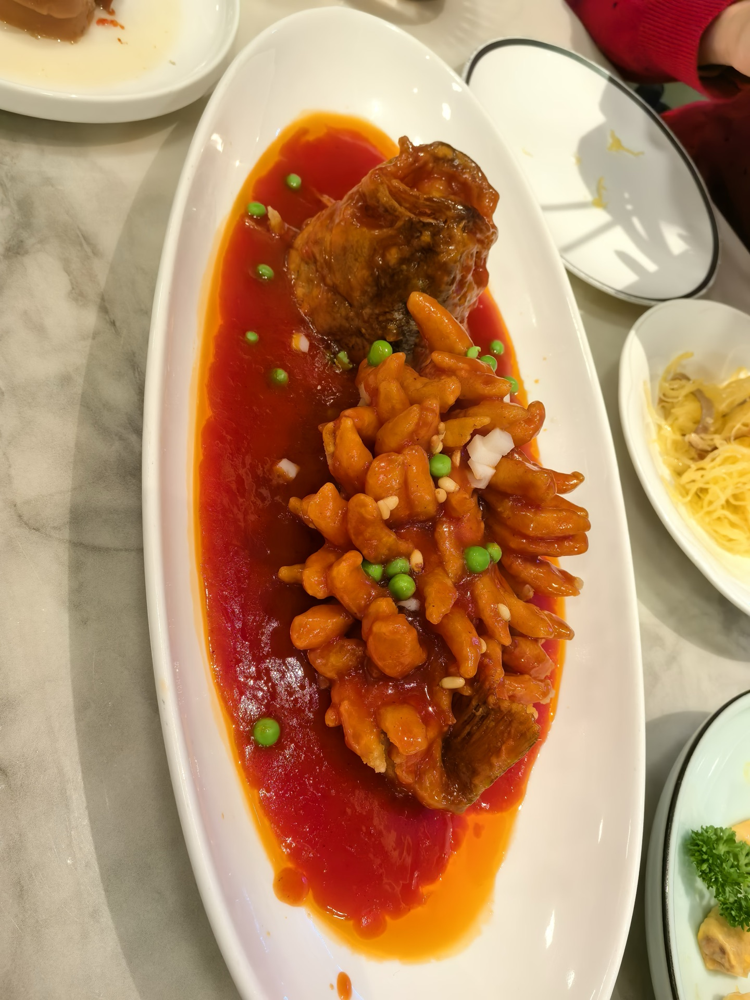
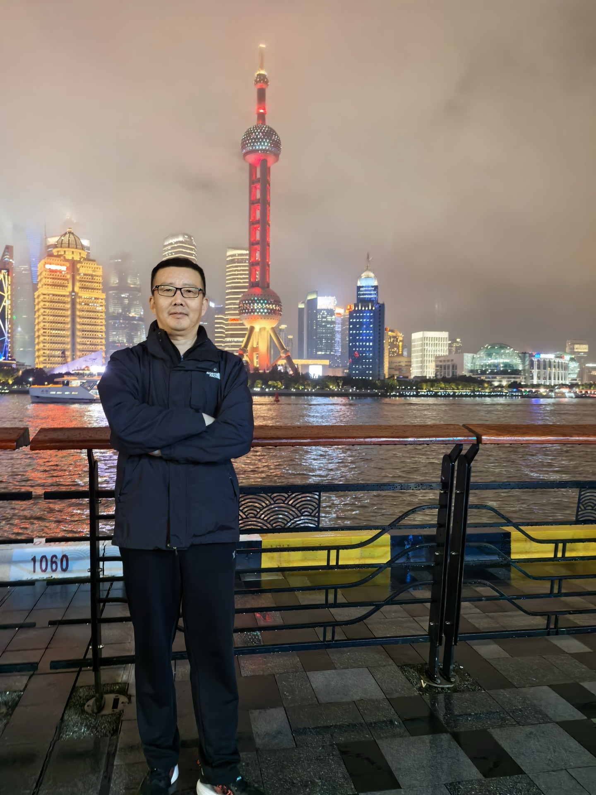

青岛学制有别于寻常，每届秋冬相交之际，常循例设中小学秋假数日。十一月初的黄海之滨，海风已渐起料峭寒意；趁着孩子课业暂歇的几日清闲，一家三口早早打点好行装，自浮山麦岛之侧启程，负暄南下，客次申江。

自二〇二六年十一月五日抵沪，至九日辞行回转，凡历五日。上海于余而言，绝非走马观花的异乡名胜，而是深埋着弱冠与而立之年奋斗足迹的故地；而于妻儿眼中，则是兼具童话奇境、现代科技与百年市井的万象之城。五日之行，分合从容，有童趣之欢、林泉之静，有名邦之盛、骨肉之慈，亦有故地之思与烟火之抚。归来灯下展卷，心潮难平，遂记此数则，以志岁月温存。

（一）动静互适：童话奇境与水乡幽步

抵沪首日，天朗气清。一家人的兴致与性情，便在此晨光初绽时自然分流。

妻儿心向童话奇境，清晨便梳洗齐整，欢天喜地直奔浦东迪士尼乐园而去，去排蜿蜒的长龙，去候欢腾的巡游，在奇幻的光影与孩童的尖叫欢呼中，尽情释放积攒多时的学业劳顿。余年逾半百，早安于淡泊素朴，向来喜静不喜闹，自是不愿在攒动人潮中耗费心力。思忖片刻，何不将这一抹澄澈秋光平分两半——她们去寻梦幻世界的喧腾，余且放步于乐园北界，探一探闻名遐迩的川沙界龙村。

步入界龙村，水网纵横如织，水杉如盖，美人蕉玉立碧波之畔。路旁既有西风东渐的星巴克，亦有香气四溢的衢州鸭头与彩票小肆，洋气与市井浑融无间，正是最鲜活的当代江南肌理。余甚至兴之所至，扫码跨上一架轻巧单车，迎着清冽的晨风一路南向寻湖，虽在乐园东侧哨卡前被温言相阻“非机动车不得涉足”，却顺势倚立于开阔湖畔，看长空云卷云舒，听微浪拍击驳岸。

她们以欢腾入胜，余以沉静会心；一幻一真，各得其趣。世间万事，本不必强求同调，各安其所而心中互念，恰是家庭行旅最自适从容的境界。

（二）申城经典：漫行历史轴线，品味本帮烟火

安顿下各自的闲趣，次日全家重合一处，开启了申城最具代表性的历史轴线寻访。

外滩临江的花岗岩近代建筑群，在清浅的初冬日光下巍然矗立。西洋古典主义的石柱、典雅高耸的钟楼，无声诉说着百余年来中西交汇的壮阔与沉浮。江风徐来，游船穿梭，十里洋场南京路步行街更是商贾云集、游人接踵，两旁的招牌霓虹与百年老字号相映生辉，处处流淌着这座国际大都会蓬勃跃动的时代脉搏。

转入豫园与老城隍庙，景致则骤然自摩登转向古雅。飞檐翘角凌空展翼，朱门黛瓦错落有致，九曲桥下碧波荡漾、锦鲤成群，四周红灯高挂，江南园林的灵秀造设与道家宫观的人间香火在此处相依相生。一路走走停停，孩童看花了眼，大人亦在这曲折回廊间寻得了几分旧时江南的温婉雅致。

游览至正午，日移中天，步履渐乏，肠胃亦适时发出抗议之声。信步踱出豫园，在寻常市井街巷中，偶遇了一家老街坊交口称赞的馆子——“1559老上海本帮菜”。

店面装潢保留着老弄堂的质朴端整，菜单翻开，皆是地道的上海传统风味，价位亦格外亲民厚道。桌上冷热齐备，而压轴登场、甫一上桌便引得全家老小齐声惊叹喝彩的，正是这家的镇店绝味——松鼠鱼。

好一尾活灵活现的松鼠鱼！只见硕大的长白瓷盘中，整尾鲜鱼已被大厨施以出神入化的麦穗花刀，通体炸得金黄酥脆，根根鱼肉挺拔舒展如松鼠耸起的蓬松长尾。刚刚出锅的滚烫鱼身之上，浇覆着厚薄恰到好处的糖醋浓汁，红亮油润，色若琥珀玛瑙，间杂点缀着几粒嫩绿的豌豆、莹白的松仁与葱末，红绿相映，煞是赏心悦目。

持筷轻夹，只听得一声极清脆的“喀嚓”轻响，外层酥壳瞬间绽裂，内里露出的则是白如初雪、极尽鲜嫩的鱼肉。入口一瞬，酸甜醇和的浓汁率先唤醒舌尖，继而是外壳的香脆与肉质的柔滑在齿颊间层层绽开；酸不刺喉，甜不粘腻，全无半分寻常淡水鱼的泥腥气。儿子连连举筷，妻子亦赞不绝口，片刻之间，大半尾鱼便在欢声笑语中落入腹中。在这异乡的秋冬街角，一盘热气腾腾、酸甜适口的松鼠鱼，不仅慰藉了口腹之欲，更让一家三口的心底生出无尽的融融暖意。

（三）浦东分流：科技求知之乐与林泉自适之清

行至第四日，浦东的广袤天地再次给予了我们各展胸臆的契机。

妻子领着儿子，专程赶赴上海科技馆。正值探索未知、对万事万物皆怀满腔好奇年纪的孩童，一踏入这方现代科学的殿堂，便如游鱼入海。从天地演化的奥秘，到物理声光的精微，再到生命地质的演进，母子二人流连于各个展厅之间，亲手触碰展品，聆听讲解，求知之乐溢于言表。

而余则安步当车，转身跨入了与科技馆仅一路之隔的世纪公园。

相比于科技馆内的熙攘探索，整座世纪公园在立冬时节呈现出一种博大深沉的宁谧。步入园中，视野顿开，大片大片的开阔草坪依然留存着苍翠的底色，林间高大的银杏已悄然染上初冬的璀璨金黄。沿着镜泊湖漫步，湖面平阔如镜，倒映着长空淡云；秋水澄澈，水鸟偶或掠波而起，荡开一圈圈轻柔的涟漪。

身在寸土寸金的陆家嘴副中心，周遭摩天楼宇若隐若现，而园内却唯闻林涛阵阵与足下落叶的沙沙轻响。余在一处临水长椅上独坐良久，深吸着草木散发出的幽凉香气，身心松弛无挂碍。古人所谓“大隐住朝市，名山苦多碍”，在这方城市绿肺之中，虽无南山之险，却足具东篱之意。

（四）血脉溯源：看望九十四岁姨奶奶

此番上海之行，最重、最温润、亦最令人动容的一桩心愿，是携妻带子专程去探望居于申城的姨奶奶——我亲奶奶的亲妹妹。

奶奶那一辈的老人，历经近一个世纪的风云变幻与沧桑坎簸，多已驾鹤西归；如今唯有姨奶奶依然安康在世，算来已整整九十四岁高龄，是全家族中硕果仅存的期颐长辈。

叩开房门，跨入整洁温暖的客厅，一眼便见到了慈祥安坐的姨奶奶。老人家虽已逾九旬高寿，却鹤发童颜，面容红润安详，眼神澄澈明亮，不仅耳聪目明，步履亦见从容，全无半点老迈颓唐之态。

见余携妻子与十多岁的重孙远道从青岛赶来省视，老人喜不自胜，眼角眉梢皆化作了化不开的笑意。她紧紧拉住余的手，又轻轻抚摸着重孙的头顶与肩膀，一口吴侬软语间杂着熟悉的山东乡音，细细询问着北方亲族的近况、家里的老宅、以及孩子的读书学业。

看着眼前这位面容清癯却神采奕奕的长辈，恍惚之间，余仿佛又看到了数十年前自己奶奶那温厚慈爱的面庞。骨肉至亲，血浓于水；纵使相隔千山万水，纵使岁月流转数十年，这种深植于基因深处的温情与牵绊，在相见的一刹那便如春水初融，毫无隔阂。

重孙乖巧地向太姨奶奶请安问候，递上精心备好的茶点与心意；老人则满心欢喜，颤巍巍地拉开抽屉，将备好的糖果与心意塞入孩子手中。四世同堂的光影在小小的客厅中静静流淌，温暖而庄严。

临别之际，老人执意送至门首，依依挥手叮咛。望着门内那张慈祥温暖的笑颜，余心头泛起无尽的感念与敬畏。九十四载风雨人生，老人家以一身从容淡泊见证了时代的更迭，这不仅是长寿的福祉，更是福泽后世的慈祥源泉。唯愿姨奶奶松柏长青、福寿绵延！

（五）申江夜话：北外滩携子看明珠，提篮桥重访旧韶光

十一月八日夜，江南立冬初度，细雨微歇，天幕低垂。

晚饭后，余特意带着儿子踱步来到了北外滩滨江步道。江畔游人三两，潮润微凉的江风拂面而来，脚下的黄浦江水浩浩汤汤奔流不息，江面上偶有满载货物的轮船拉响悠长的汽笛，划破夜空的宁谧。

凭栏极目远眺，对岸陆家嘴的天际线在夜幕中璀璨生辉。而最夺目者，莫过于矗立在水天之间的东方明珠广播电视塔。塔身今夜披覆着极为通透纯正的中国红华彩，宛如一支自苍穹直插江渚的巨型火炬，十一颗球体流光溢彩，与水中的倒影交织成一片绚烂夺目的流金幻彩。

儿子见此奇景，兴致勃然，主动从余手中接过手机：“爸，您站过去，靠在栏杆上，身后的东方明珠正好看得真切，我给您拍一张！”

余欣然驻足，双手抱臂于胸前，迎着江风倚栏而立。镜头对焦的刹那，快门轻响，将这份跨越两代人的温情与两岸的夜色永久定格。

看着眼前身姿已近成人、眼神中闪烁着清朗之气的儿子，余忍不住指向对岸那座巍峨的电视塔，与身侧这片历经更新的北外滩街区，向他娓娓道起一段陈年旧事——

那是整整二十四年前的二〇〇二年，余年方二十有八，正如今日之青年才俊，风华正茂。彼时受浪潮通用软件公司重托，独身受命派驻上海，入驻东大名路700号中国海运集团总部，研析全集团的内部资金管理系统。

白日里，我们在那栋赭红色的现代大厦里日夜攻坚，推敲一行行关键代码与银企直联架构；黄昏散工，便回转到不远处提篮桥街角的一栋三层弧形转角小洋楼客舍歇息。晚饭后，常与同组好友宋君信步漫步至公平路渡口，花上区区“五毛钱”，乘着柴油轮渡迎风过江，绕着刚刚建成的东方明珠漫步一周。两个二十出头的年轻程序员，在江风中仰望着世纪地标，畅谈技术架构，笑谈人生理想，心头如长空般清朗辽远……

白日里余已独自重回过那一带。东大名路700号的大厦依然雄伟如初，而提篮桥那栋见证过青年韶光的三层青灰砖小楼，身侧昔日喧嚣的人行过街天桥已荡然无存，底层商肆亦被整排木板封存待拆。岁月如同一把无情的刻刀，悄然抹去了一座城市的旧容颜，却抹不去当年在这里挥洒过的热血与青春。

如今，二十四年弹指而过，当年在轮渡上吹着江风的青年，已生华发；而身边站立的，已是自己茁壮成长的儿子。

儿子静静聆听着父亲年轻时的过往，抬头望向那座通红耀眼的明珠塔，眼神中多了一份对时光与奋斗的深思。两代人的青春与岁月，在这浩荡的浦江晚风中，完成了最深沉、最从容的对话与交接。

（六）尾声：归心似舟，清欢常驻

九日午后，整理行装，辞别申城，踏上返青之途。

短短五日，如白驹过隙，却充盈饱满、韵味悠长。这一趟旅程，成全了孩子的欢畅与求知，陪伴了妻子的游兴与从容；在豫园的市井弄堂中品尝了老上海本帮菜的温润醇美，在九十四岁姨奶奶膝前温习了血脉亲情的浩荡慈深；更在北外滩与提篮桥的微雨清风中，重温了二十四载前自己的青春履痕，完成了父子间的精神传承。

人生如逆旅，我亦是行人。世间万千繁华，终将归于平淡；而真正能够穿透岁月风霜、沉淀在生命深处的，无非是眼前至亲的欢声笑语，心头挚友的清澈坦荡，以及历尽沧桑之后对这人间烟火的深情相待。

申江秋色已深，东篱霜华渐浓。归来煮一壶新茶，围炉坐看云起，心中坦坦荡荡，天地一片澄明。
