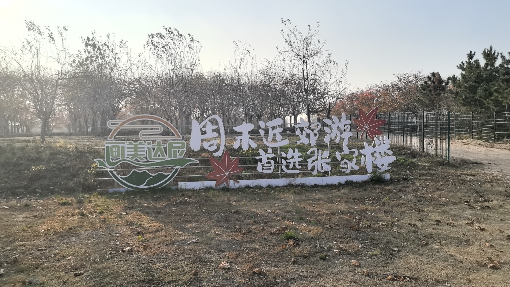
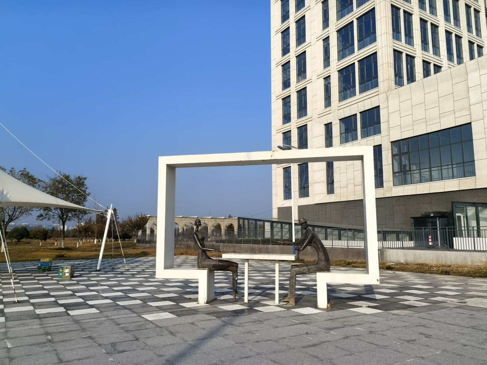
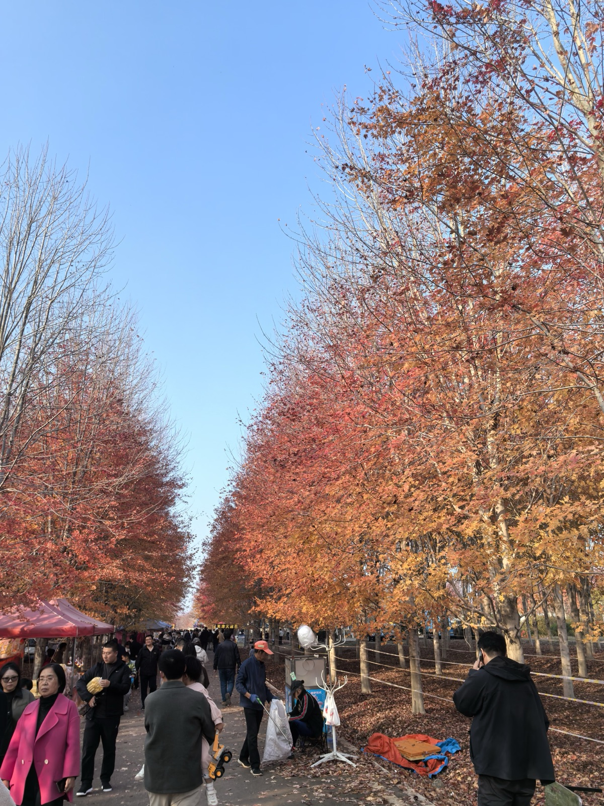
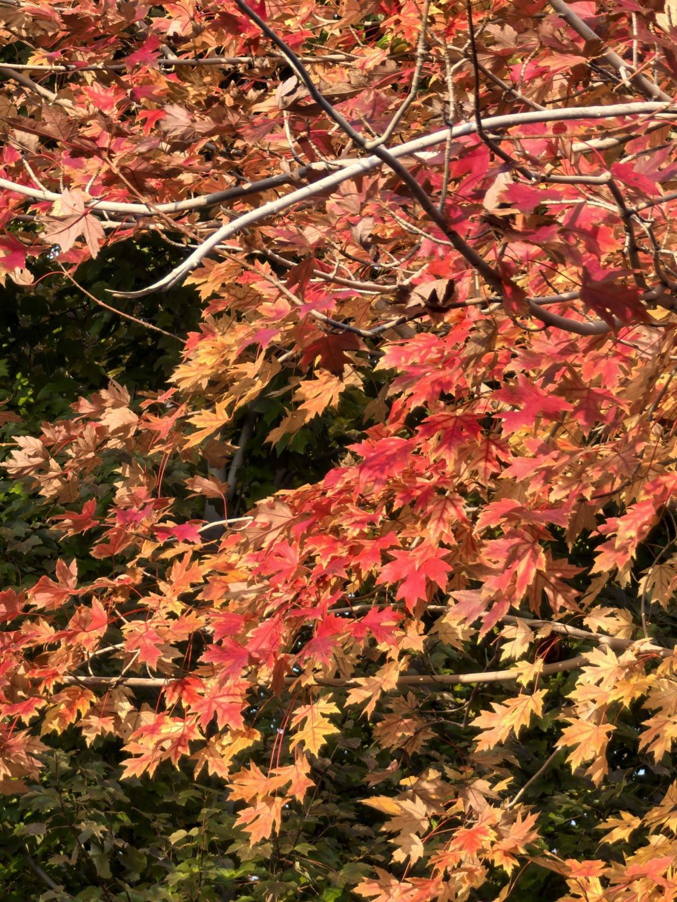
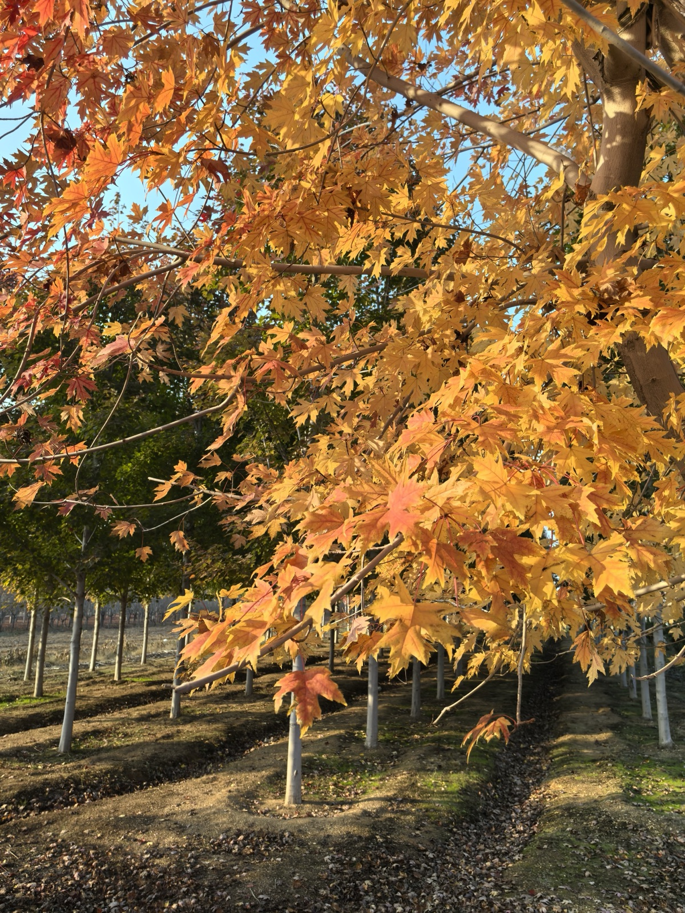

立冬方过，黄海之滨的海风已透出微凉，天宇却愈发高远澄澈。丙午初冬十一月十四日午后，晴光明媚，案牍之劳暂歇，心念忽动——西海岸新区张家楼的千亩红枫，想来正是霜华洗染、色相最浓的时节。未作迟疑，余整衣拂袖，一人驱车西去，赴一场初冬草木之约。

张家楼素负“江北第一画家村”之盛名，亦称达尼画家村。车至村口，赫然立着一处彩绘照壁，上题“画美达尼，周末近郊游首选张家楼”，缀以数枚朱红枫叶，朴茂中透着田园之趣。

村中不仅草木繁秀，更处处流淌着林泉与丹青相融的野趣。在文化艺术中心前开阔的广场上，黑白棋盘方砖错落铺陈，一尊白框雕塑兀自静立：框中二人对坐闲谈，似论画法，似叙心曲。欧式拱廊与现代展馆在碧空下相映成画，未入枫林，已先浸染了三分从容画意。

转出画家村，循路而进，便步入了名动齐鲁的张家楼千亩枫叶林。

初冬的阳光毫无遮拦地倾泻而下，眼前豁然展开一片铺天盖地的斑斓火海！数以万计的北美红枫连绵起伏，枝头红叶如朝霞漫卷、似烈焰腾空，与未落的金黄叶片交织错落，将整条林荫大道装点成一条浓烈深邃的秋色画廊。时逢周末，游人如织，老少携游，笑语盈盈；贩售糖葫芦与棉花糖的小车点缀其间，人间烟火气与大自然的壮阔相融相洽，毫无违和，反添生机。

余信步脱离喧闹的人流，往枫林深处徐行。近观枫叶，片片形若分明的手掌，经初冬霜气催逼，红得纯粹炽热，几若朱砂珊瑚雕琢而成，在深绿松柏的映衬下愈显明艳。偶有微风吹拂，叶片如千百只丹凤振翅，沙沙作响，旋即飘落一两枚，稳稳停在肩头或掌心，温润而静谧。

林间整饬的田垄向远处延伸，夕阳西斜，金灿灿的光柱斜斜穿透树冠，在起伏的田垄泥土上映照出长长的树影。金黄与朱红在光影变换中流转，万木静穆，大地深沉。

古人常借秋暮起悲，余独爱这初冬霜叶胜于春花之盛。一人独步，无促膝寒暄之累，有骋目放怀之乐。天地设此绝色，何须名家妙手挥毫？在这画家村的广袤林海间，山川自是一卷摊开的巨幅丹青。踏着落叶徐徐归去，胸次廓然，心满意足。
