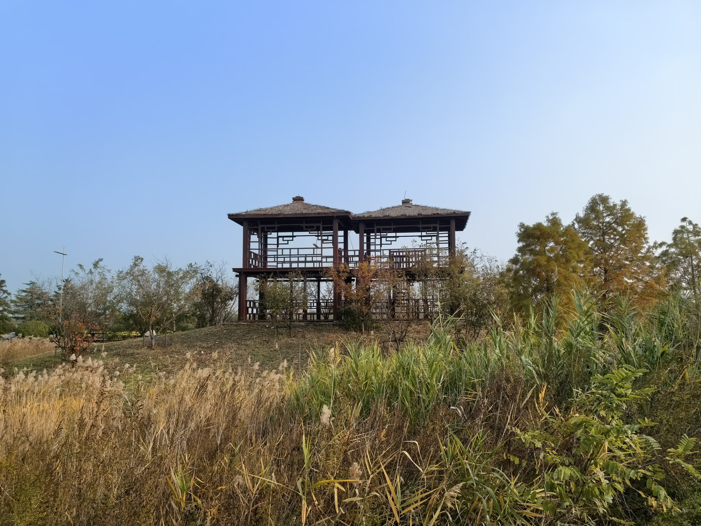
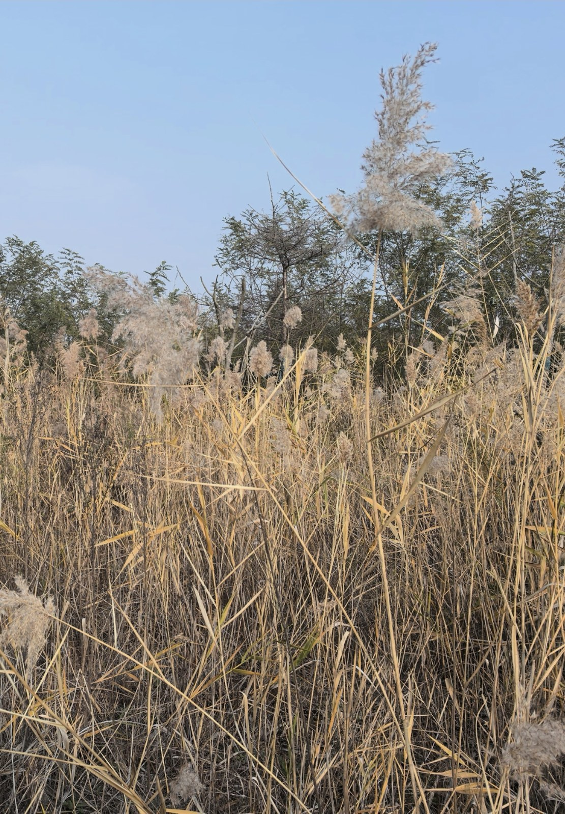
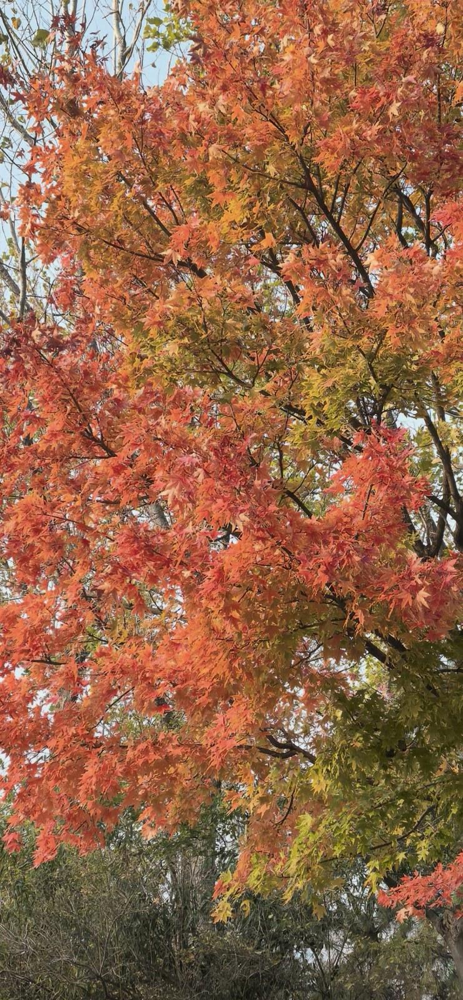
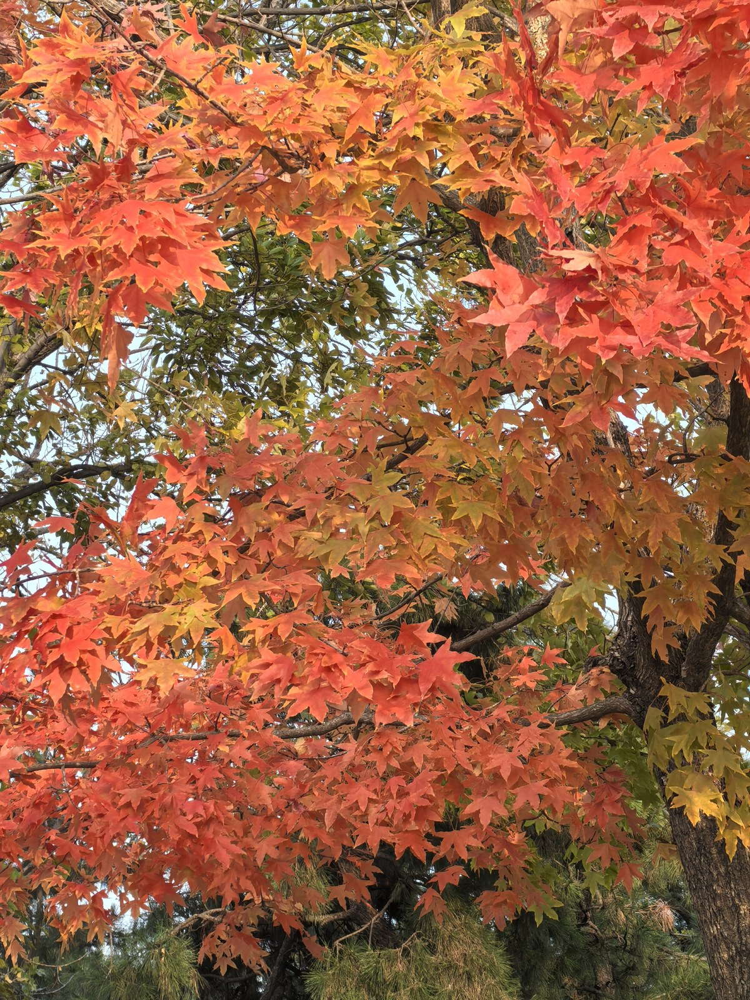
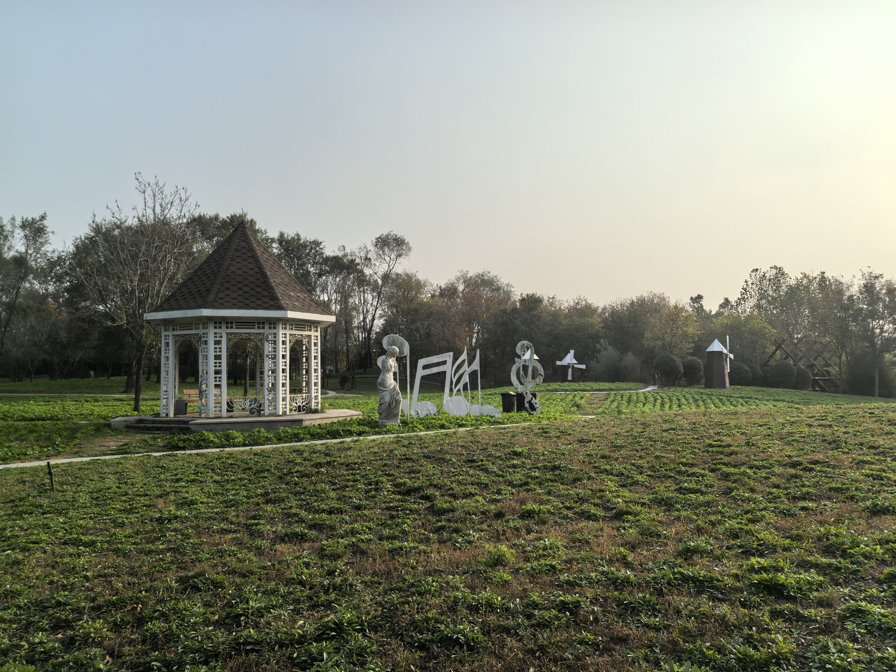

岁月无声，如白驹过隙。忽有一日蓦然回首，自移居黄岛算起，不知不觉已在这片海湾畔生活了整整十五个年头。十五年间，昔日隔海相望、略显寂寥的黄岛，已在时代波澜中蝶变腾飞，更名为气象万千的国家级“青岛西海岸新区”。跨海飞梁如虹，海底隧道穿波，高楼广厦如笋拔节，城市日新月异，而余鬓角亦添霜雪。

三十年来，因求学、行商、顾问银行业务与架构系统之故，余行色匆匆，登车揽辔，足迹遍踏大江南北。北上燕赵京畿，南下沪滨粤海，西出巴蜀秦川。天南海北、名山大川乃至天涯海角，亦曾饱览惊涛拍岸之雄奇、万国楼宇之繁华。然而羁旅客枕，阅尽千帆，每逢归期，倘问心底最眷恋、最教人从容笃定的去处何在？答曰：唯吾家门首之唐岛湾。

唐岛湾素有“海上西湖”之美誉，南抱凤凰岛，北倚主城区，古时曾见证宋金海战之金戈铁马，如今早已化作一方海不扬波、万物滋荣的滨海胜境。它不似外海长滩那般狂暴奔放，却自有海湾独有的宽仁与静穆。尤其是深秋初冬之交，海风不疾，天宇如洗，风景更胜春朝。

丙午十月初七午后，案牍稍歇，余信步来到湾畔，赴一场初冬之约。

沿着岸线木栈道徐行，临水缓坡之上，一处双联重檐的木构草亭静静伫立于秋草与疏木丛中。青瓦铺顶，茅草披檐，凭栏木栅质朴无华，宛然有陶令结庐、东篱归隐之古意。登亭远眺，唐岛湾水色澄碧，波平如镜；微凉的海风穿堂而过，拂面不寒，极目处海天一色，顿觉胸次清朗，尘虑皆消。

转入湿地滩涂深处，万顷芦苇已尽披金黄。

一人多高的芦苇在海风轻拂下起伏如浪，雪白轻盈的芦花飞絮漫天舒展，直抵浩渺如洗的青天。芦秆沙沙作响，恍若大自然低声倾诉着岁月的沧桑与从容。天地苍茫，旷野寂然，秋水共长天一色，平添几分幽远出尘的野趣。

踏出湿地，漫步至林荫曲径，忽见数株北美红枫拔地而起，巍然成盖。

举目仰视，整座树冠经霜露催逼，红黄相间，如火如荼，灿若朝霞漫天铺展。近前细细端详，枫叶经络分明，色相纯粹明艳，宛如朱砂美玉细细雕琢而成，在午后斜阳的映照下温润泛光。草木有节，阅尽风霜而愈显风骨，令人驻足良久，流连忘返。

再向前行，开阔平缓的滨海草坪在斜阳下舒展身姿。

一座洁白典雅的圆顶欧式凉亭宛若海滨画境，安详矗立于草坪之上；草畔横陈着五线谱音符雕塑，伴随着典雅静穆的希腊雕像与远处徐徐转动的荷兰风车，在天光水色间相映成趣。自然天成的湿地野趣与典雅浪漫的现代园景在此相融相谐，海风微拂，似有一阕悠扬的乐章在湾畔回旋不绝。

苏东坡曾有词云：“试问岭南应不好，却道：此心安处是吾乡。”

客居黄岛十五载，回首当年，亦曾以为此地不过是漫长人生旅途中的一处客栈；然而日久年深，不知不觉间，早已将他乡作了故乡。走遍天下，阅尽繁华，始知最美的风景从未在远方，而就在日日守候的这一汪碧海、一抹红叶与万倾芦花之间。暮色渐起，踏着落霞缓步而归，远近灯火渐次明灭，心中唯留安宁与丰盈。
