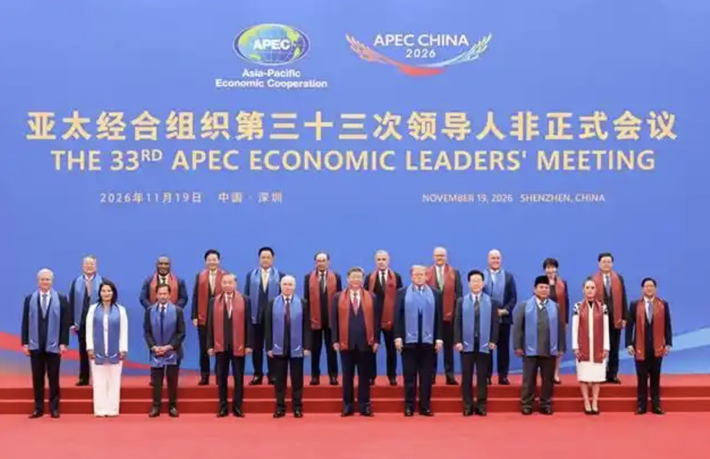
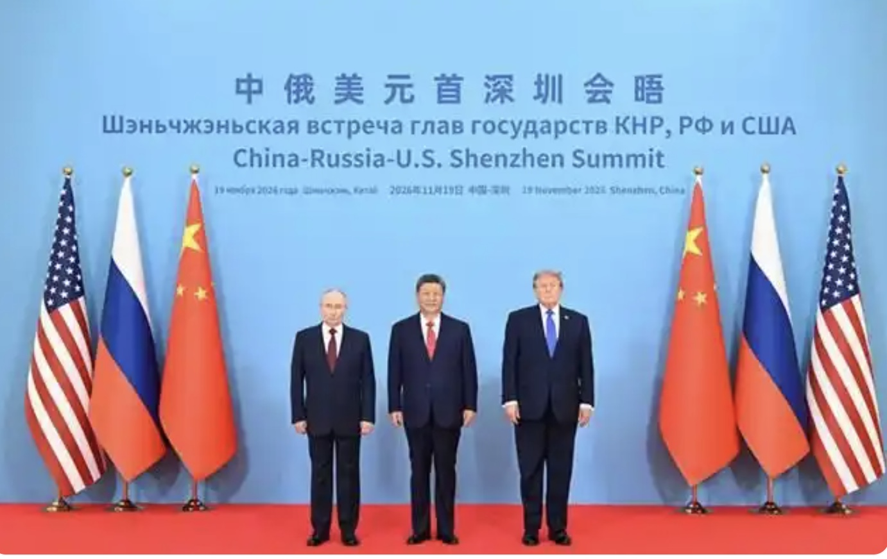

初冬小雪时节，窗外海风微凉，案头茶香初袅。近日从荧屏与报端欣闻，亚太经合组织（APEC）第三十三次领导人非正式会议在深圳圆满召开。南海之滨，春潮激荡；来自亚太各经济体的领导人跨越山海，齐聚这片见证了改革开放奇迹的热土，共商开放包容、创新增长与区域合作的大计。五洲宾朋相聚一堂，锦绣披肩，气象从容，展现出亚太大家庭携手并进的融融暖意。

而最令天下普通百姓瞩目且内心激荡的，莫过于会议期间迎来的历史性一幕——“中俄美元首深圳会晤”。在三方国旗庄严映衬下，中美俄三国最高领导人并肩而立，神情笃定，坦诚相对。据世人记忆所及，这不仅是数十年来国际舞台上难得一见的顶峰同框，更是在风云激荡、战火阴霾未散的国际大变局下，给全球注入的最为珍贵的一剂定心良药。

余不过是一介寄情草木、僻居东篱草堂的平民布衣。数十载求学行商、阅历世事，深知这世间烟火万家，最渴望的无非是柴米油盐的安稳，最敬畏的莫过于生命的尊严与岁月的静好。放眼近年来的全球局势，地缘冲突频仍，炮火硝烟让无辜生灵颠沛流离，经济壁垒亦使发展脚步蒙尘。历史早已反复证明：对抗没有赢家，兵戈唯有创伤；大国和，则天下安；大国斗，则万民殃。

如今，大国领袖能够在东方明珠深圳平心静气相聚晤谈，本身就是对人类命运与全球繁荣的一份沉甸甸的担当。这不仅是元首之间外交智慧的展现，更是全人类对安定与发展的共同期盼所汇聚的大势所趋。作为千千万万普通人中的一员，欣见此景，内心由衷感到欣喜、慰藉与振奋。

杜甫曾有诗云：“安得广厦千万间，大庇天下寒士俱欢颜”；陶潜亦向往“黄发垂髫，并怡然自乐”之世外桃源。行至岁晚，愿各国能以此次深圳会晤为破冰与前行的新契机，相向而行，求同存异；多通商以促繁荣，多对话以消猜忌，少一些硝烟与战乱，多一份理解与仁爱。衷心祝愿四海升平，五洲和睦，愿天下苍生免于恐惧与漂泊，愿我们的世界更加美好、更加和谐。
